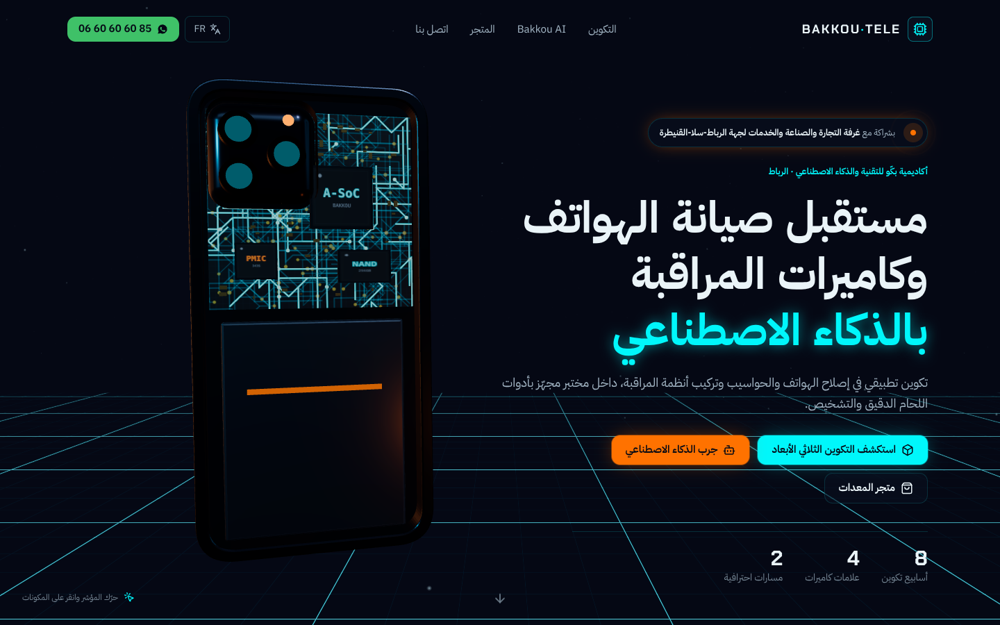
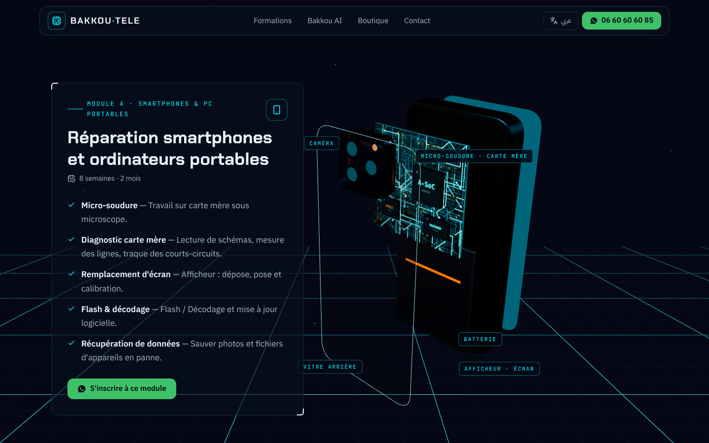
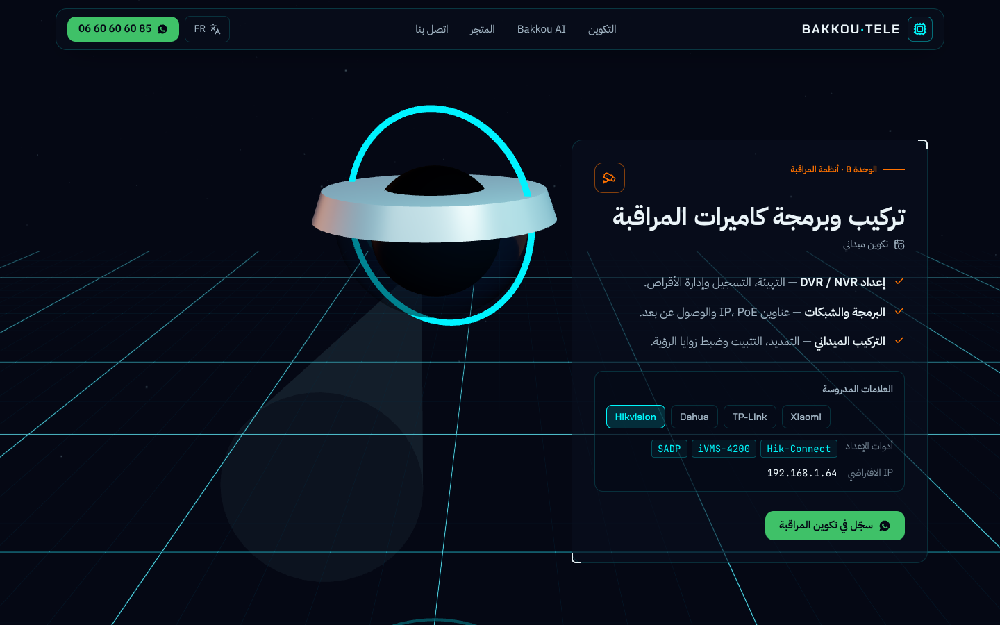
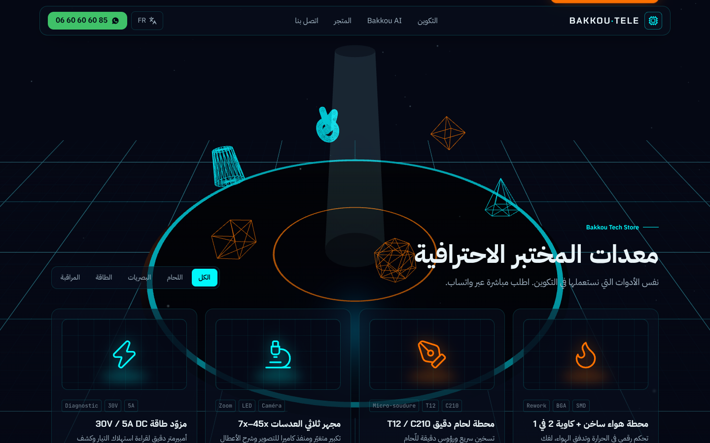
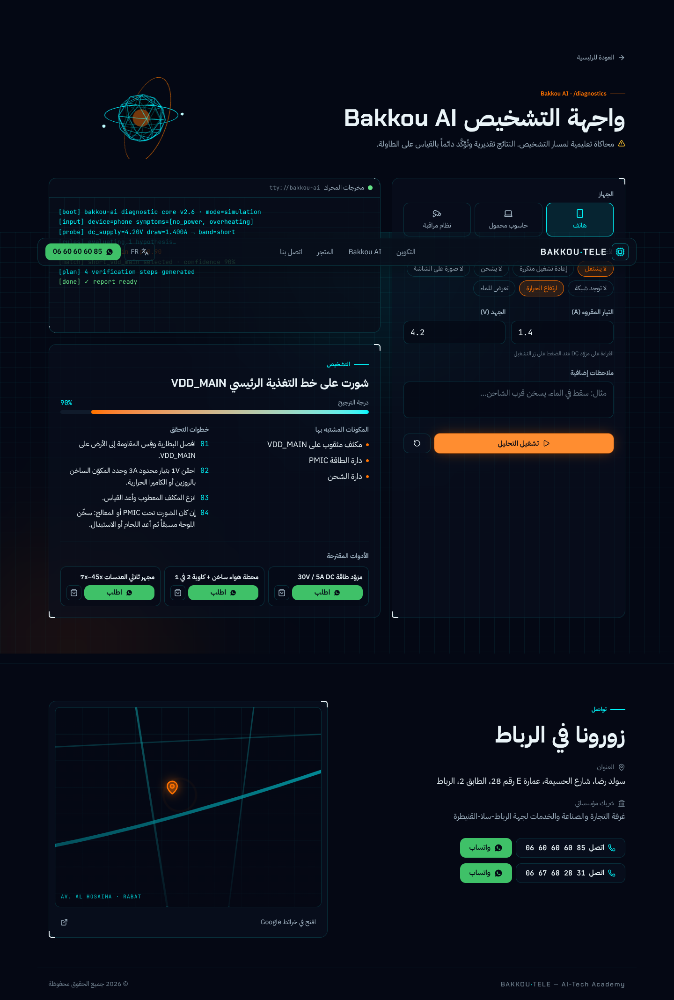
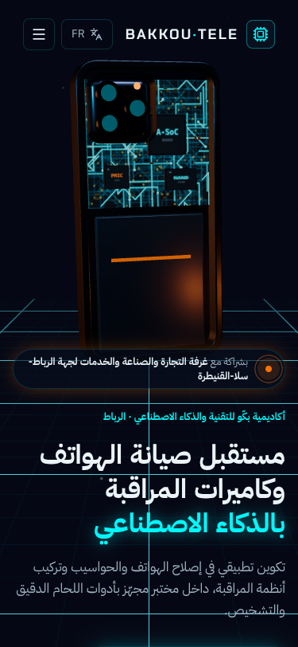

# Bakkou Tele — AI-Tech Academy (Rabat)

Site 3D immersif : Next.js 16 (App Router) + React Three Fiber + GSAP ScrollTrigger + Tailwind v4, bilingue AR (RTL, par défaut) / FR (LTR).

```bash
npm install          # .npmrc active legacy-peer-deps (postprocessing ↔ three)
npm run dev          # http://localhost:3000
npm run build && npm start
npm run qa           # Playwright + axe (serveur lancé sur :3000)
npm run qa:install   # مرة واحدة: تحميل متصفح Chromium لـ Playwright
```

## Structure

```
app/
  layout.tsx            polices, I18nProvider, Navbar, Footer (#contact)
  page.tsx              Experience (canvas fixe) + sections
  diagnostics/page.tsx  interface Bakkou AI
  api/diagnose/route.ts flux texte ligne par ligne + "@@RESULT {json}"
components/
  Experience.tsx        détection du niveau d'appareil, ScrollTrigger → stage caméra, repli 2D
  Navbar / HeroSection / TrainingSection / AITeaser / StoreSection / Footer / AIDiagnostic
  three/Scene3D.tsx     Canvas, CameraRig (6 keyframes), particules, Grid, Bloom
  three/MotherboardModel.tsx  smartphone procédural éclatable, composants cliquables
  three/CCTVModel.tsx   dôme IP avec cône de balayage
  three/AICore.tsx, LabScene.tsx, CoreCanvas.tsx, textures.ts
lib/
  data.ts               contact, partenaire, produits, marques CCTV, lien WhatsApp
  i18n.tsx              dictionnaires AR/FR + direction du document
  scene.ts              état partagé DOM ↔ boucle de rendu, niveau d'appareil
  diagnosticEngine.ts   moteur de règles (téléphone / PC / CCTV)
qa/qa.cjs               captures 375/768/1440, FR, reduced-motion, 2D, axe, parcours diag
```

## Points clés
- **Caméra pilotée au scroll** : un seul ScrollTrigger convertit le scroll en `stage` continu (0 hero → 5 contact), lu à chaque frame sans re-render React.
- **Performance** : `high` (bloom, dpr ≤ 1.75), `low` (≤ 4 cœurs / mobile : pas de post-traitement, moins de particules), `none` (pas de WebGL, Save-Data ou `?2d`) → illustration SVG. `PerformanceMonitor` dégrade automatiquement. Les objets hors champ ne sont pas rendus.
- **Forçage** : `?2d`, `?low`, `?lang=fr`.
- **Prix** : non affichés (« prix sur demande ») — à compléter dans `lib/data.ts` si souhaité.
- **Bakkou AI** est une simulation pédagogique à règles, pas un modèle IA ; à brancher sur un vrai LLM plus tard via `app/api/diagnose`.

## Captures (QA Playwright)

| Hero (AR) | Module A — vue éclatée (FR) |
|---|---|
|  |  |
| **Module B — CCTV** | **Boutique** |
|  |  |
| **Diagnostic Bakkou AI** | **Mobile 375 px** |
|  |  |
